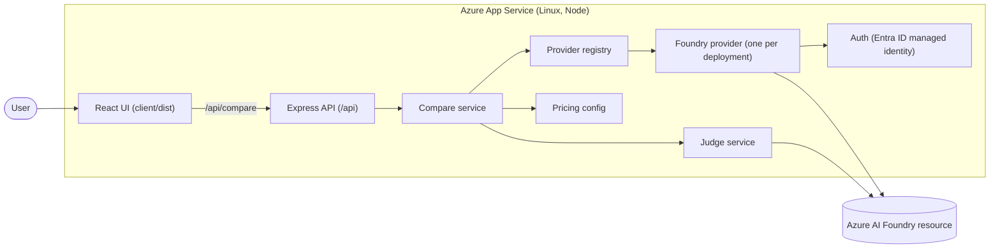
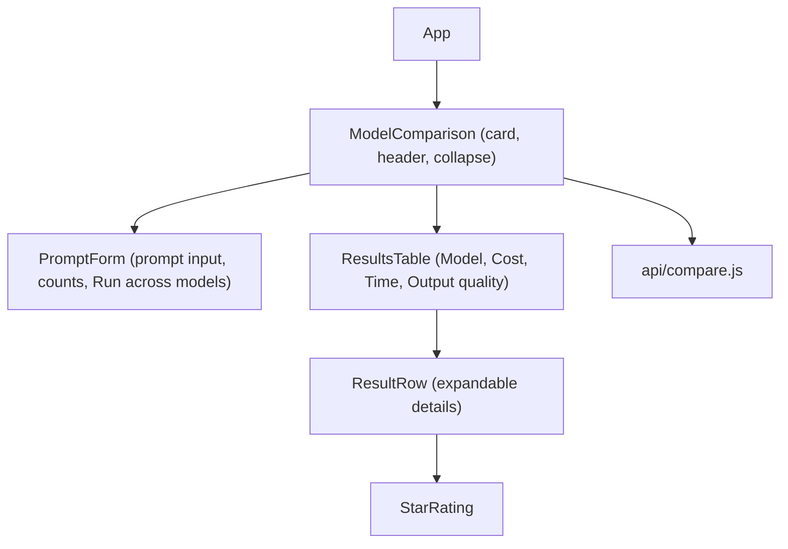
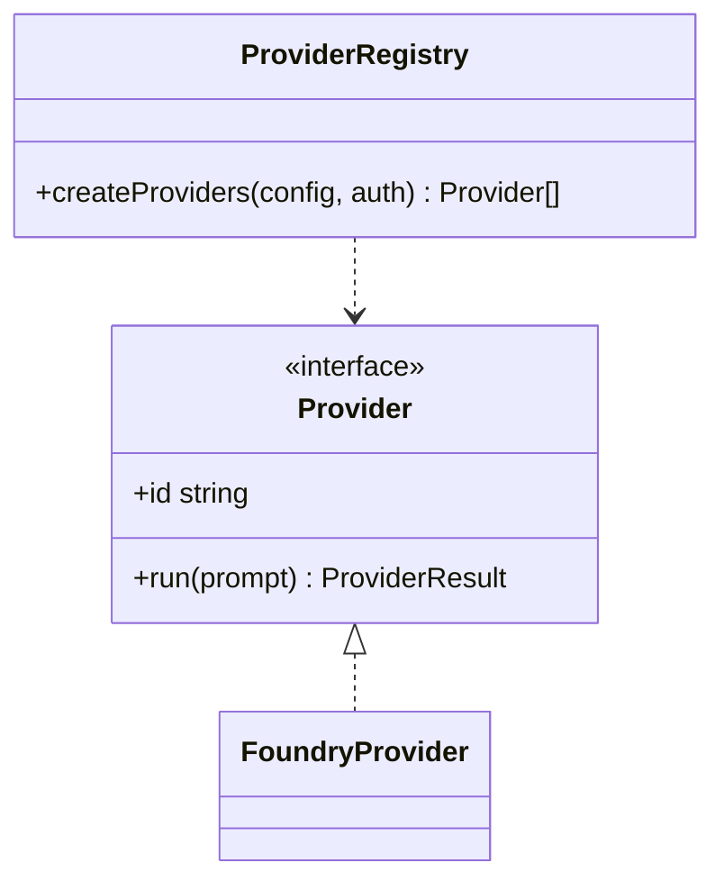
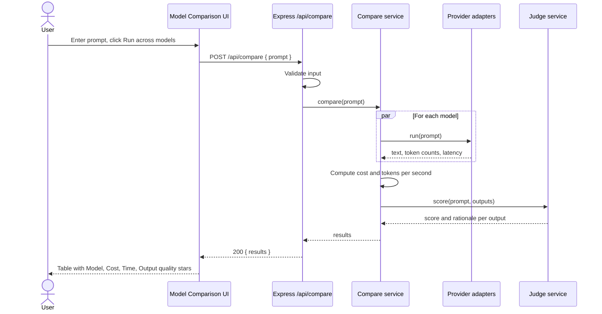
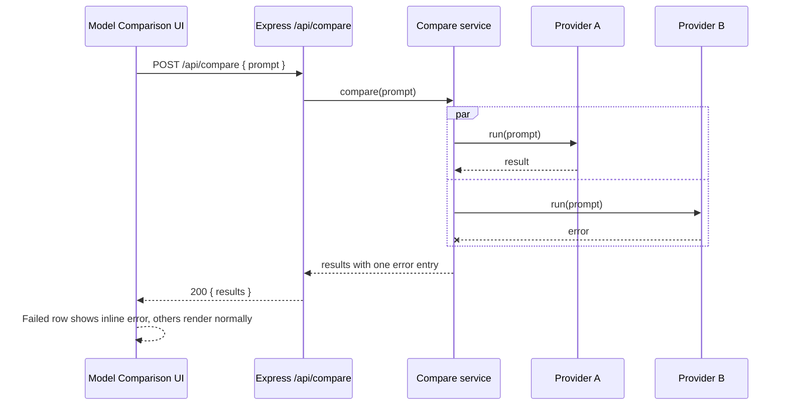
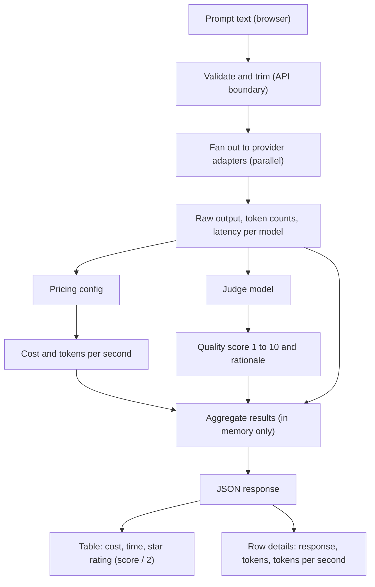
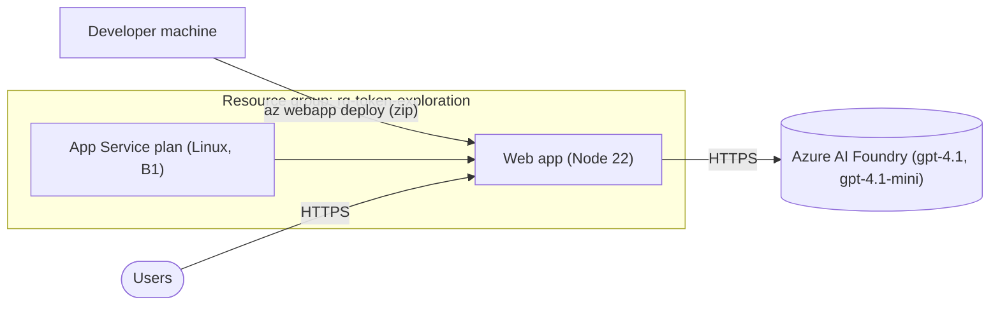

# Token Exploration: Architecture and Diagrams

Companion to [plan.md](plan.md). All diagrams use Mermaid.

## System Architecture

## Client Component Structure

## Provider/Adapter Class Structure

## Sequence Diagram: Run Comparison

## Sequence Diagram: Partial Failure

## Data Flow Diagram

No data is stored: prompts, outputs, and scores exist only in memory for the duration of the request and in client state.

## Deployment Topology

