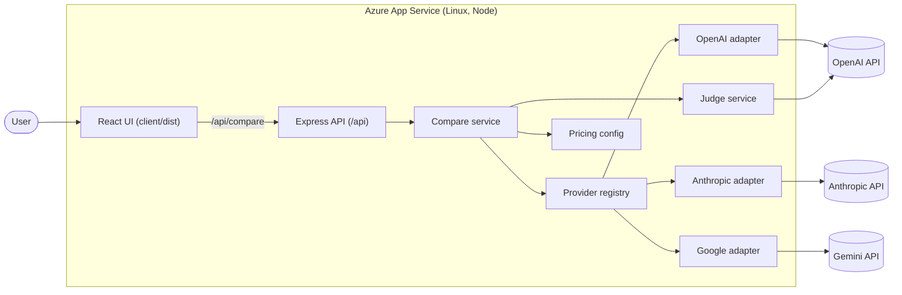
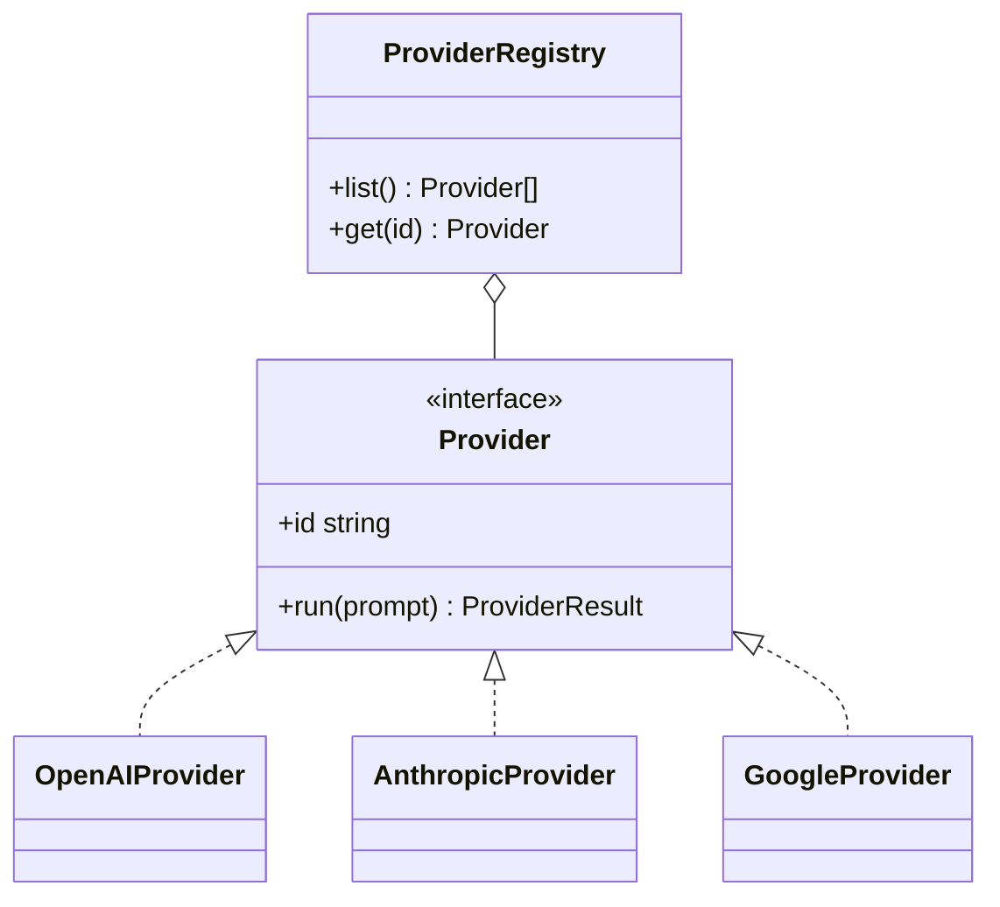
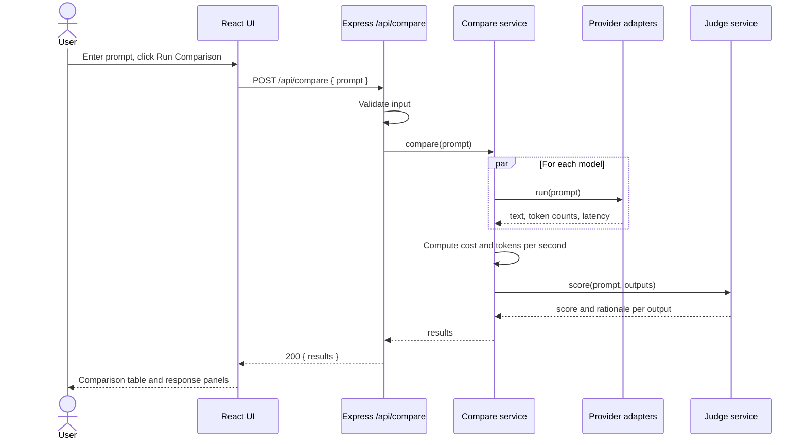
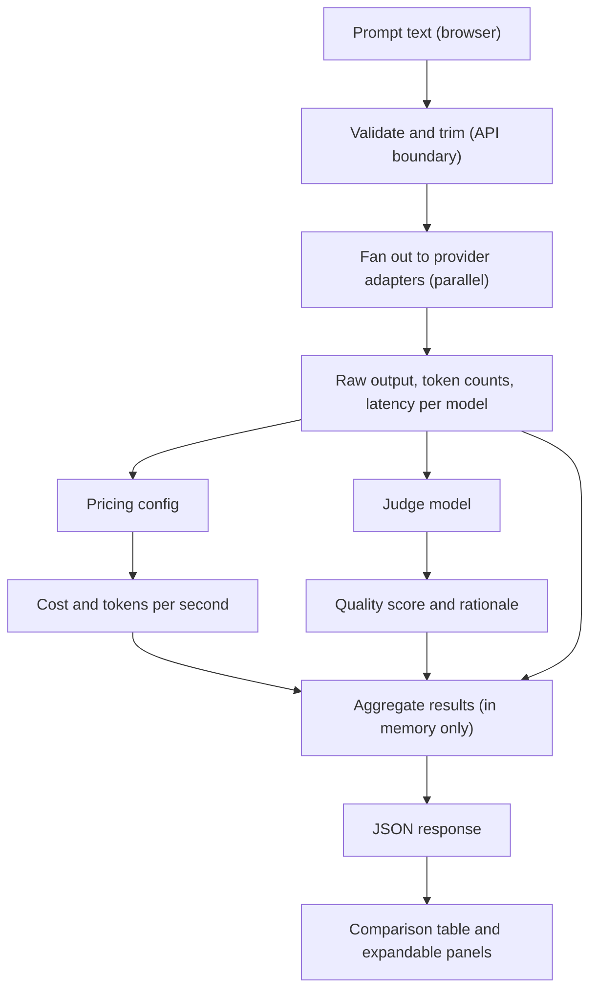

# Token Exploration Web Application

## Objective

Build **Token Exploration**, a responsive web application on top of the existing Node.js (Express) + React (Vite) monorepo. A user enters a single one-shot prompt and compares the performance of multiple Large Language Models (LLMs) on that exact prompt.

The application helps users understand trade-offs between:

- Cost
- Response time
- Output quality
- Token usage

The application is lightweight and stateless. **Do not use a database or persist any data.**

## User Story

As a user, I want to enter a prompt once and execute it across multiple AI models so that I can compare which model provides the best balance of quality, speed, and cost.

## Scope and Status

- Status: planning only. No implementation has started.
- Reuses the existing app: Express API in `server/`, React + Vite UI in `client/`, npm workspaces, ES modules.
- Replaces the original Next.js, TypeScript, Tailwind CSS, and shadcn/ui requirement. The existing stack and conventions in `.github/copilot-instructions.md` apply.
- Llama 3 is out of scope.

## Supported Models

The first version supports:

- GPT-4o
- Claude 3.5 Sonnet
- Gemini 1.5 Pro

Adding a model must only require a new provider adapter and a pricing entry; no changes to the route, UI table, or judge.

## Core Workflow

### Step 1: User Enters Prompt

UI contains:

- Large text area, placeholder: `Enter your one-shot prompt here...`
- Character count
- Estimated token count
- "Run Comparison" button (disabled while running or when the prompt is empty)

### Step 2: Execute Across Models

On Run, the identical prompt is sent to all configured models in parallel. For each model capture:

- Model name
- Input, output, and total token counts
- Response time (latency)
- Tokens per second
- Estimated cost
- Full generated output
- Error, if the call failed (a failing model must not fail the whole comparison)

### Step 3: Compare Results

A comparison table with these columns:

| Model | Input Tokens | Output Tokens | Total Tokens | Cost | Time | Output Quality |
| --- | --- | --- | --- | --- | --- | --- |

Beneath the table, expandable panels show the full response for each model.

## Output Quality Scoring

- A configurable judge model (default GPT-4o, set with `JUDGE_MODEL`) scores each response from 1 to 10 against the original prompt.
- The judge returns structured JSON: `{ "score": number, "rationale": string }`. Invalid judge output is treated as "not scored" and shown as such.
- Responses are judged without revealing which model produced them.

## Cost Calculation

- Pricing is configuration, not code: `server/src/config/pricing.js`, USD per 1M input and output tokens per model.
- Cost = `inputTokens / 1e6 * inputPrice + outputTokens / 1e6 * outputPrice`.
- A model with no pricing entry reports cost as unavailable.

## Performance Metrics

Track and display per model: response time, tokens per second, total tokens, cost.

## Technical Requirements

### Frontend (`client/`)

- React function components and hooks, Vite.
- All HTTP calls in `client/src/api/`.
- Loading, error, and empty states; per-model error display.
- Accessible, responsive layout.

### Backend (`server/`)

- Express routes under `/api`.
- Provider/Adapter pattern in `server/src/providers/`:
  - Common interface: `run(prompt) -> { text, inputTokens, outputTokens }`.
  - One adapter per vendor (OpenAI, Anthropic, Google), registered in a provider registry.
  - Services: `compare` (parallel fan-out with `Promise.allSettled`), `judge`, `pricing`.
- Input validated at the API boundary (prompt required, trimmed, maximum length).
- Errors returned as `{ "error": { "message": string } }`.
- API keys only from environment variables; never logged or returned to the client.

### Configuration (documented in `.env.example`)

| Variable | Purpose |
| --- | --- |
| `PORT` | Server port (Azure provides this) |
| `CORS_ORIGIN` | Allowed origin in development |
| `OPENAI_API_KEY` | GPT-4o and default judge |
| `ANTHROPIC_API_KEY` | Claude 3.5 Sonnet |
| `GEMINI_API_KEY` | Gemini 1.5 Pro |
| `JUDGE_MODEL` | Judge model id (default GPT-4o) |
| `MAX_PROMPT_CHARS` | Prompt length limit |

## API Endpoints

### Run Comparison

`POST /api/compare`

Request:

```json
{ "prompt": "string" }
```

Response:

```json
{
  "results": [
    {
      "model": "gpt-4o",
      "inputTokens": 12,
      "outputTokens": 240,
      "totalTokens": 252,
      "latencyMs": 1830,
      "tokensPerSecond": 131.1,
      "costUsd": 0.0024,
      "output": "string",
      "quality": { "score": 8, "rationale": "string" },
      "error": null
    }
  ]
}
```

### Health Check

`GET /api/health` returns `{ "status": "ok" }`.

## Architecture

### System Architecture



### Provider/Adapter Class Structure



### Sequence Diagram: Run Comparison



### Data Flow Diagram



No data is stored: prompts, outputs, and scores exist only in memory for the duration of the request and in client state.

## Testing Requirements

- Server: `node:test` + `supertest`. Client: Vitest + Testing Library.
- Unit tests for every provider adapter (mocked vendor SDK/HTTP), registry, pricing, compare service, judge service, validation, and every UI component and API module.
- Integration tests for `POST /api/compare` and `GET /api/health` with mocked providers, covering success, partial model failure, all models failing, invalid input, and judge failure.
- Coverage target: 90% or higher, enforced in CI scripts.
- **All unit and integration tests must pass successfully.** `npm test`, `npm run lint`, and `npm run build` must all exit with code 0 before the work is considered done or deployed.

## Documentation Requirements

- Update `README.md` with setup, environment variables, scripts, and deployment.
- Keep the architecture, class, sequence, and data flow diagrams in this plan current (Mermaid).

## Deployment Criteria (Azure App Service)

Deployment may proceed only when all of the following are true:

1. `npm test` passes (unit and integration), coverage is at least 90%.
2. `npm run lint` and `npm run build` pass.
3. In production, Express serves the built client (`client/dist`) and `/api` from a single process, with SPA fallback for non-API routes.
4. The server listens on the port provided by Azure (`process.env.PORT`).
5. A root `npm start` script runs the server in production mode; Node engine is declared in `package.json`.
6. No secrets in the repository; API keys are set as App Service application settings.
7. `GET /api/health` is configured as the App Service health check path.
8. HTTPS only is enabled.
9. After deployment, `/api/health` returns 200 and a real comparison runs end to end.

## Deployment Steps

Target: one Linux App Service running Node 22 that serves both UI and API. Method: Azure CLI zip deploy. The user signs in with `az login`; credentials are never shared in chat or committed.

Defaults (change before deploying if needed): region `westeurope`, SKU `B1`, resource names below.

```text
Subscription : e8f2b54a-b92d-410e-ba91-81fdc2cdcff5
Resource group: rg-token-exploration
App Service plan: asp-token-exploration (Linux, B1)
Web app: token-exploration-<unique-suffix>   (name must be globally unique)
```

1. Verify locally: `npm install`, `npm test`, `npm run lint`, `npm run build`.
2. Sign in and select the subscription:

   ```powershell
   az login
   az account set --subscription e8f2b54a-b92d-410e-ba91-81fdc2cdcff5
   ```

3. Create the resource group and plan:

   ```powershell
   az group create --name rg-token-exploration --location westeurope
   az appservice plan create --name asp-token-exploration --resource-group rg-token-exploration --is-linux --sku B1
   ```

4. Create the web app:

   ```powershell
   az webapp create --name <app-name> --resource-group rg-token-exploration --plan asp-token-exploration --runtime "NODE:22-lts"
   az webapp update --name <app-name> --resource-group rg-token-exploration --https-only true
   az webapp config set --name <app-name> --resource-group rg-token-exploration --startup-file "npm start" --generic-configurations '{"healthCheckPath": "/api/health"}'
   ```

5. Set application settings (the user supplies the key values locally; they are not stored in the repo):

   ```powershell
   az webapp config appsettings set --name <app-name> --resource-group rg-token-exploration --settings NODE_ENV=production OPENAI_API_KEY=<value> ANTHROPIC_API_KEY=<value> GEMINI_API_KEY=<value> JUDGE_MODEL=gpt-4o
   ```

6. Build and package: `npm run build`, then zip the app (server source, built `client/dist`, root and server `package.json` files, lockfile) excluding `node_modules`. Dependencies are installed by App Service during deployment.
7. Deploy:

   ```powershell
   az webapp deploy --name <app-name> --resource-group rg-token-exploration --src-path app.zip --type zip
   ```

8. Smoke test: open `https://<app-name>.azurewebsites.net`, confirm `/api/health` returns 200, and run a comparison.
9. Rollback: redeploy the previous zip, or delete the resource group `rg-token-exploration` to remove all resources.

## Implementation Phases (not started)

1. Server: config and pricing, provider interface and adapters, registry, compare and judge services, `POST /api/compare`, tests.
2. Client: prompt form with counts, comparison table, response panels, `api/compare.js`, tests.
3. Production readiness: static serving of `client/dist`, start script, engines, `.env.example`, README.
4. Verification: tests, lint, build, coverage at least 90%.
5. Azure deployment following the steps above.

## Definition of Done

A user can enter a single prompt, run it against GPT-4o, Claude 3.5 Sonnet, and Gemini 1.5 Pro simultaneously, and compare cost, latency, token usage, quality score, and generated output without any database or persistent storage. All unit and integration tests pass, coverage is at least 90%, and the application is deployed and reachable on Azure App Service.
